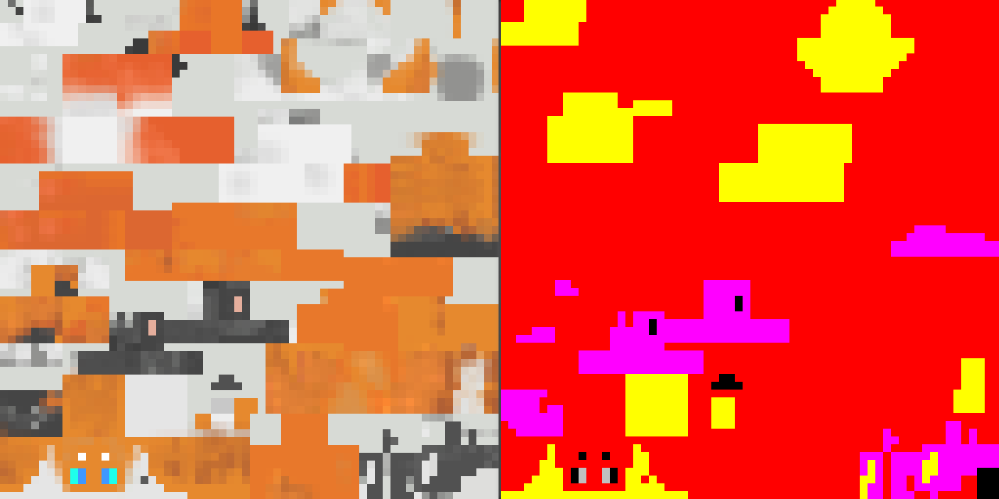

# 为自定义形态加入换色功能

为了让你的自定义形态支持游戏内的颜色自定义（以及可视交互调色菜单），你需要制作对应的 `colormask` 贴图，并在 `assets/<命名空间>/ssc_form_model/` 下的模型配置文件中进行注册

## 一、创建 colormask 贴图



`colormask` 贴图以形态原贴图为基础绘制，通过 RGBA 通道标记各自定义颜色的生效区域：

| 通道 | R | G | B | A (value = 0) | A (value = 1) |
| :---: | :---: | :---: | :---: | :---: | :---: |
| 对应区域 | 主要色 | 强调色1 | 强调色2 | 眼睛颜色1 | 眼睛颜色2 |

- 颜色覆盖顺序为：**主要色 → 强调色1 → 强调色2 → 眼睛颜色**（后者覆盖前者）
- 模组在生成自定义颜色贴图时会自动混合原贴图的灰度纹理，因此 `colormask` 仅作区域标注使用，涂成纯色即可

## 二、在模型配置文件中注册

在 `assets/<命名空间>/ssc_form_model/origins.origin.<命名空间>.<origin名>.json` 中，根据你使用的贴图图层添加对应的 `*_mask` 字段：

- `texture` → `texture_mask`（基础贴图蒙版）
- `overlay` → `overlay_mask`（叠加层贴图蒙版）
- `fullbright_texture` → `fullbright_texture_mask`（自发光贴图蒙版）
- `emissive_overlay` → `emissive_overlay_mask`（呼吸式全身发光叠加层蒙版）

配置示例：

```json
{
  "load_priority": 0,
  "name": "example_namespace.form_example.model_name",
  "layer": "origins:origin",
  "form": "example_namespace:form_example",
  "wide_only": true,

  "model": "example_namespace:geo/form_example.geo.json",
  "texture": "example_namespace:textures/form_example.png",
  "texture_mask": "example_namespace:textures/form_example_colormask.png",
  "fullbright_texture": "example_namespace:textures/form_example_emission.png",
  "fullbright_texture_mask": "example_namespace:textures/form_example_emission_colormask.png",
  "hidden": [
    "leftLeg", "rightLeg", "rightPants", "leftPants",
    "body", "jacket"
  ],

  "animation_system": "shape-shifter-curse:default",
  "animation_system_config": {
    "tail": {
      "chain": {
        "tail": [0, 1, 2, 3]
      }
    }
  }
}
```

配置完成后重新加载资源包，即可在形态调色菜单中对该形态进行换色
