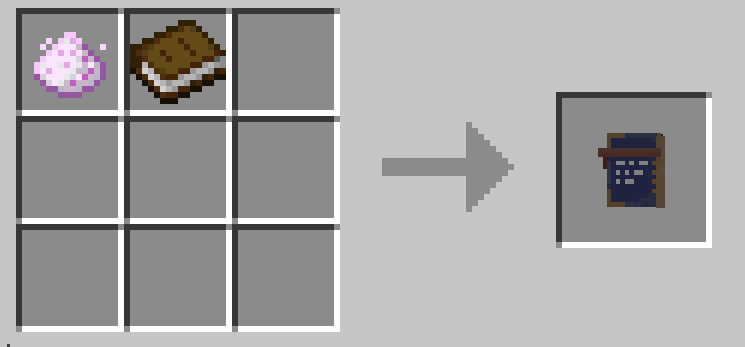

# 概览

在安装mod并第一次进入游戏时，您会获取一个名为`幻形者之书`的可使用物品

点击右键使用，并选择`打开幻形者之书`将会为您开启mod的内容

在之后的游玩中，`幻形者之书`也是用于确认您当前所处形态的介绍、优势与劣势、以及本能信息的重要道具

### 不慎丢失了幻形者之书？



您可以随时使用`未加工的月尘`\+`书`合成一个新的

`未加工的月尘`可以在`诅咒之月`事件期间获取，也可以直接合成，详细请参考`模组添加的物品`与`形态的变化与复原指南`

---

## 自定义开局初始形态（服务端 / 整合包）

在1.10.0版本之后，服务端或整合包作者可以配置玩家进入新存档时直接获得的初始形态，从而跳过传统的“打开幻形者之书”开局流程，或让玩家以指定/随机形态开始游戏

要启用这一功能，需要同时满足以下条件：

1. 在通用配置文件 `config\shape-shifter-curse-common.toml`（或 Mod Menu 配置界面）中将 `enableInitialForm` 设为 `true`
2. 确保世界游戏规则 `sscUseInitialForm` 为 `true`（默认为 `true`，可通过 `/gamerule sscUseInitialForm true|false` 随时开关）
3. 在配置项 `initialFormIds` 中填入一个或多个候选形态，格式为 `命名空间:形态ID:权重`（支持数据包自定义形态），新玩家加入时会按权重随机抽取一个作为初始形态：

```toml
enableInitialForm = true
initialFormIds = [
    "shape-shifter-curse:original_before_enable:1",
    "shape-shifter-curse:bat_0:2",
    "shape-shifter-curse:ocelot_0:1"
]
```

!!! note

    - 初始形态配置**仅对尚未选择形态的新玩家生效**，不会覆盖存档中已有玩家的当前形态
    - 如果同时将通用配置项 `immediatelyTransform` 设为 `true`，玩家触发变形时将跳过渐变动画瞬间完成变形
    - 如果你希望未打开幻形者之书的玩家也能被变形药水或女巫投掷的药水影响，可以在通用配置中按需开启 `statusPotionWithCurse` 与 `witchPotionForPreBook`