# 形态专属工具与饰品

在1.8.1版本之后，模组添加了各种形态专属的工具与饰品。它们可以显著地增强或变更当前形态的能力，从而丰富游玩体验

饰品需要依赖 `Trinkets`、`Curios` 或 `Accessories` 模组

!!! note

    在1.10.0版本之后，**原有的 13 件基础形态饰品已从工作台迁移至`幻形祭坛`合成**（配方材料与图案不变，仅需在祭坛中消耗少量月尘燃料）

    同时新增了 12 件 **`+` 进阶升级饰品/工具**：将基础物品与对应形态的`催化核心`（不消耗）放入`幻形祭坛`并消耗 16 份月尘即可升级，详见`幻形祭坛与催化核心`一节

    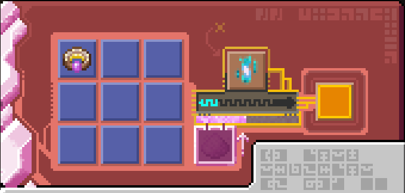

## 月尘晶砾与月尘纯晶

要合成这些专属工具与饰品，进阶材料`月尘纯晶`是不可或缺的

要获取`月尘纯晶`，你可以使用`未加工的月尘`、`下界石英`和`恶魂之泪`合成`月尘晶砾`并放入熔炉/高炉熔炼；在1.10.0版本之后，也可以直接在`幻形祭坛`中合成`月尘纯晶`

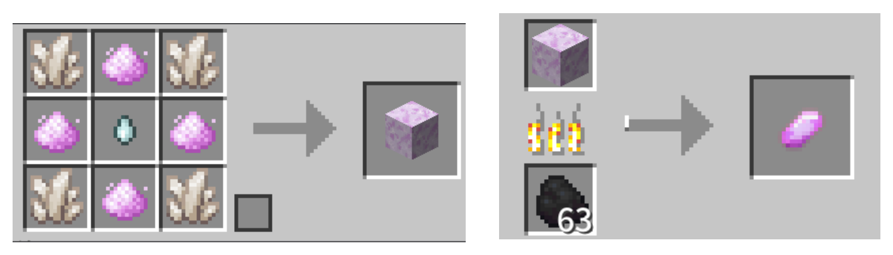

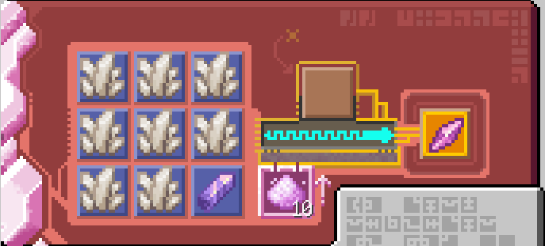

## 合成方式与效果

### 蝙蝠形态

* 黑夜水晶吊坠：

    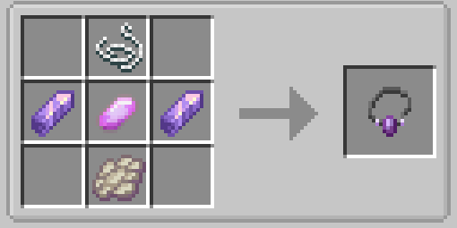

  你不会再在阳光下降低生命值上限

  **黑夜水晶吊坠+（暗夜催化核心）**：在黑暗中获得额外抗性提升

* 空心牙吊坠：

    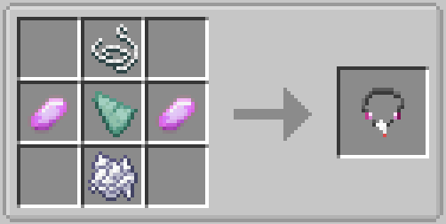

  你的攻击可以吸取生命值与饥饿值，但是不再能从食物中获取恢复

  **空心牙吊坠+（暗夜催化核心）**：近战攻击额外附带中毒效果

* 固着抓钩：

    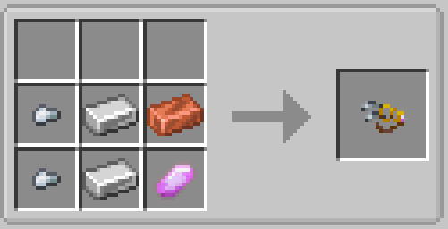

  武器与工具不再会脱手，不过其耐久度消耗提高

  **固着抓钩+（暗夜催化核心）**：挖掘方块后获得急迫效果

* 金刚石握爪：

    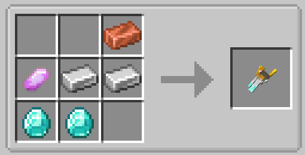

  [工具]需要有力的前爪来使用。增加挖掘效率与伤害，同时当握持这一工具时，你攀附墙壁的能力不会受到影响。在1.10.0版本之后被归类为通用工具（覆盖镐、斧、铲、锄类方块）

### 羽族（蝙蝠子形态）

羽族可沿用蝙蝠形态的饰品；此外，解锁羽族技能树中的`工具改造`节点后，可在背包中制作以下专属武器：

* **石墨烯薄刃**：在背包中用`煤炭块`右键点击`金剑`制作。低耐久、高伤害的近战利刃
* **复合动能弓**：在背包中用`钻石`右键点击`弓`制作。高耐久，且发射箭矢的基础伤害提升

### 豹猫形态

* 肾上素颈环：

    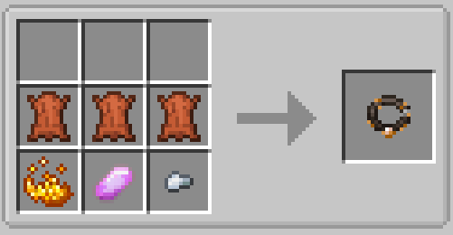

  只适用于真正的狩猎者。你的爪击与扑击的伤害提升，但是不再能自动闪避投射物

* 猫胡须颈环：

    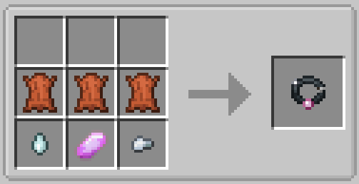

  只适用于真正的狩猎者。当你触发闪避能力时会给与临时的生命恢复效果

  **猫胡须颈环+（密林催化核心）**：成功闪避时额外获得力量效果

* 消化毛球：

    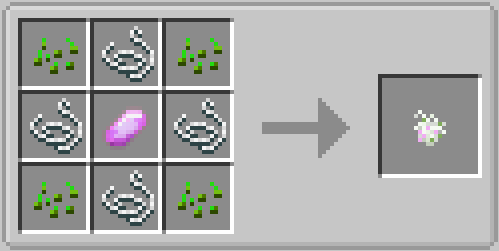

  让你可以消化熟肉与素食，不过它们的恢复效率依然较低

  **消化毛球+（密林催化核心）**：食用生肉时获得长时间的伤害吸收效果

### 雪狐形态

* 计度温护符：

    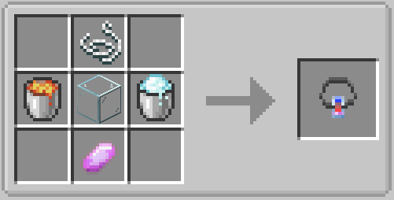

  反转寒冷群系与炎热群系对你的生命上限的影响

  **计度温护符+（冻霜催化核心）**：在高温环境中额外获得迅捷效果

* 结霜护爪：

    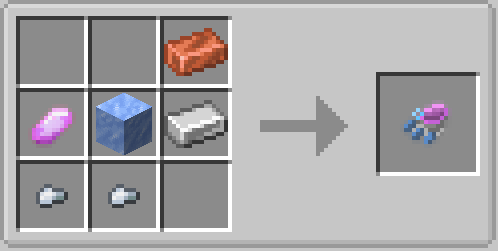

  需要强大的冰之魔力来发挥作用。你投掷的雪球会对命中范围造成迟缓效果，但是伤害降低

  **结霜护爪+（冻霜催化核心）**：进一步增强范围迟缓效果

* 瓶装暴雪：

    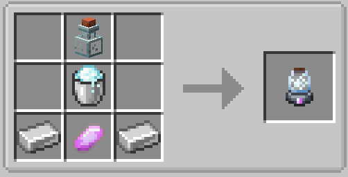

  [工具]需要强大的冰之魔力来使用。以一些饥饿值为代价，凝结并发射雪球

  **瓶装暴雪+（冻霜催化核心 + 末影水晶）**：发射雪球不再消耗饥饿值

### 使魔红狐形态

* 守御脚环：

    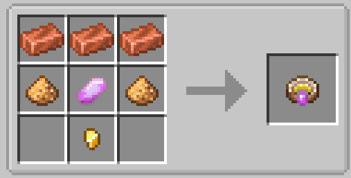

  你不再会受到女巫与唤魔者的强制影响，从敌对生物吸取魔力时不再受到副作用

  **守御脚环+（磷火催化核心）**：从敌对生物吸取的魔力量大幅增加

### 美西螈形态

* 喷泉腰带：

    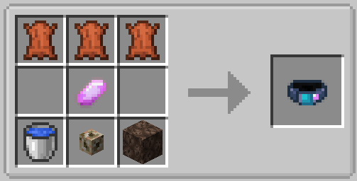

  需要强大的水流能力来生效。水流爆破不再造成伤害，而是将你与周围的实体一起推向空中

  **喷泉腰带+（浪涌催化核心）**：触发时额外获得缓降效果

### 胡狼形态

* 凋零裹布：

    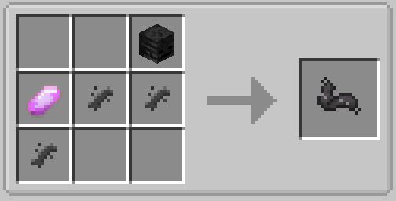

  你受击时获得的凋零效果等级降低，但是持续时间更长

  **凋零裹布+（沙丘催化核心）**：进一步大幅延长受击后自身的凋零持续时间，提供更长的强化攻击窗口

### 蜘蛛形态

* 箭毒纺锤：

  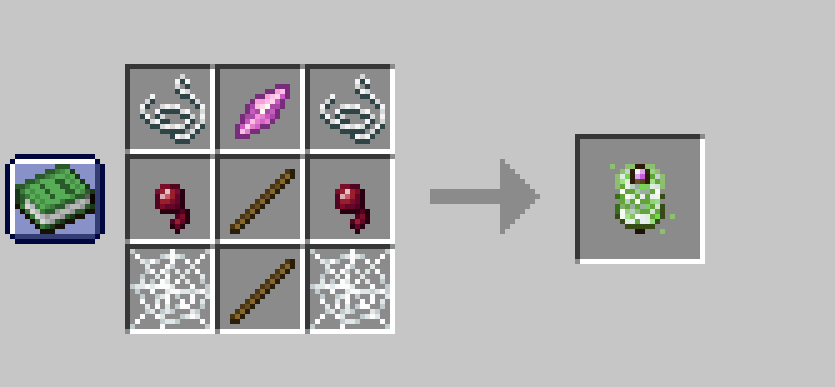

  蛛丝弹命中生物时造成伤害，并用中毒替换其迟缓与缠身效果

  **箭毒纺锤+（丝网催化核心）**：蛛丝弹命中时造成伤害、中毒、虚弱并保留缠身效果

* 副手斧

  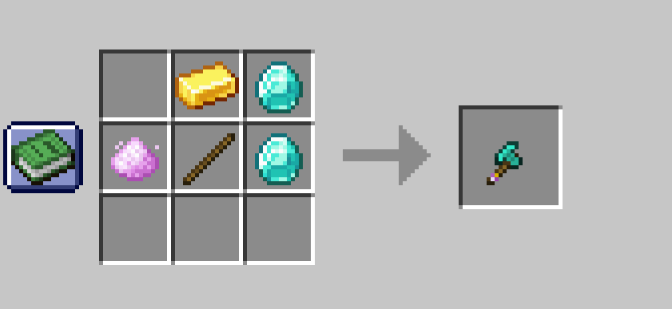

  装备在第二双手上时提升近战攻击力，但是攻速减慢

* 副手剑

  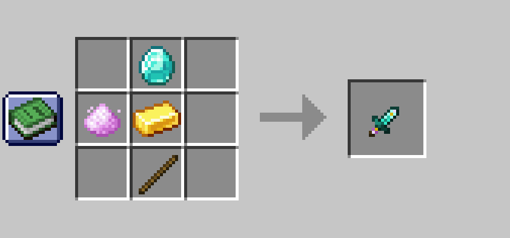

  装备在第二双手上时提升近战攻速，但是消耗武器的更多耐久

* 副手镐

  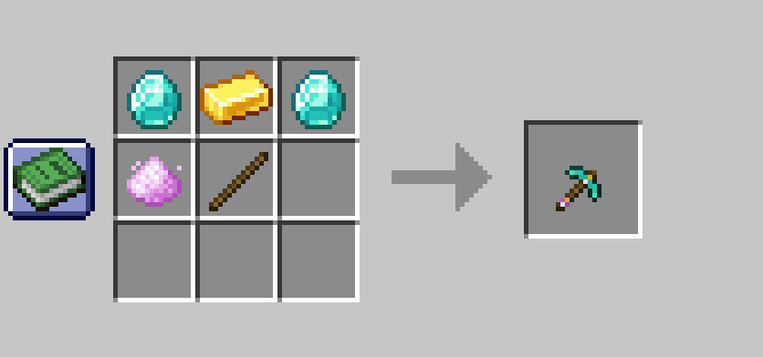

  装备在第二双手上时提升挖掘效率，但是降低近战攻击力

* 蛛丝弹

  解锁蜘蛛技能树中的`丝弹稳定化`后，可在背包中用`蛛网`右键点击`蛛网`制作，作为可投掷的蛛丝弹使用

### 悦灵形态

* 共振晶核

    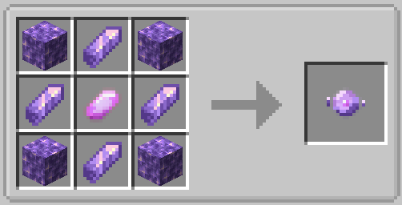

  食用紫水晶碎片会对周围的实体施加生命恢复效果，但是不再恢复饱和值

    
    