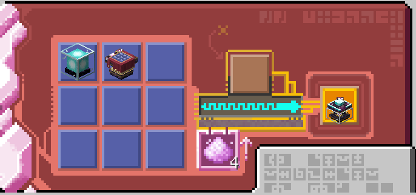
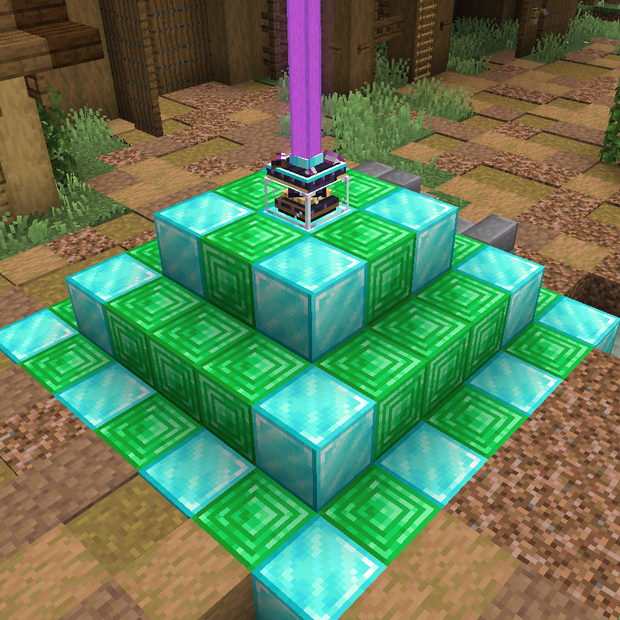
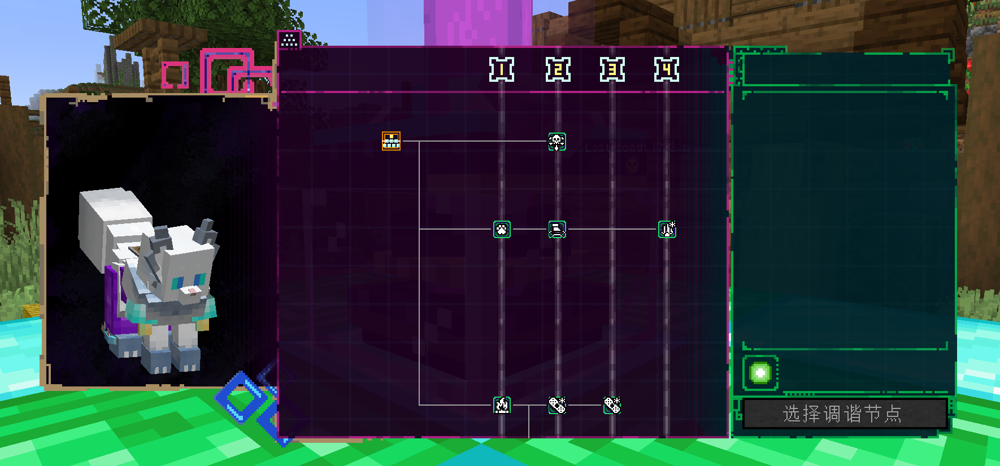

# 形态调谐与技能树

在1.10.0版本之后，所有拥有`永久阶段`的形态以及`子形态`均拥有独立的`形态技能树`（Perk），允许你在到达终态后进一步发掘形态潜力、补足固有短板，或解锁全新的主动能力

## 形态调谐信标

要解锁技能树中的节点，你需要先在`幻形祭坛`中使用原版`信标`与`幻形祭坛`合成`形态调谐信标`

`形态调谐信标`的搭建方式与原版信标相同：在主世界中将信标放置在由矿物块（铁块、金块、绿宝石块、钻石块、下界合金块等）搭建的金字塔基座上。基座铺设的层数（1~4 层）决定了调谐器的阶数，进而决定可以解锁到技能树的第几阶

!!! note

    `形态调谐信标`仅在主世界生效；你也可以像原版信标一样在光柱上方放置染色玻璃来改变光柱颜色

## 解锁技能树节点

处于永久形态或子形态时，右键`形态调谐信标`即可打开`形态调谐`界面

- 技能树按阶数横向展开，需要按照前置连线依次解锁节点，且调谐信标的基座层数需满足节点对应的阶数要求
- 解锁节点需要消耗**经验点**（直接扣除经验点数而非整级）或**微光棱柱**
- 如果只是想随时查看当前形态的技能树内容，可以在按键设置中绑定`开启技能树界面`快捷键进行预览，不过实际解锁节点仍需要前往`形态调谐信标`

## 主动能力按键

!!! note

    1.10.0版本新增了`主动能力 (1)`至`主动能力 (6)`以及能力轮盘切换按键，**这些按键默认均未绑定**。解锁或使用形态主动能力前，请务必前往游戏设置中的`控制 → 按键绑定`自行分配键位

- 形态原有的部分主动操作也已统一整合至主动能力按键（例如美西螈的`水流爆破`由`主动能力 (1)`触发；豹猫的`潜行边缘掉落切换`由`主动能力 (6)`触发）
- 如果觉得 6 个独立按键过多，也可以使用`上一个/下一个能力绑定`、`激活滚轮切换能力按键`配合`激活选中的能力绑定`来集中切换与释放

## 各形态技能树概览

为了避免过度剧透，以下仅简要概括当前 9 棵技能树的强化方向，具体节点效果请在游戏中通过调谐界面查看：

- **蝙蝠形态**：优化地面姿态与抗日晒能力，解锁`回声定位`、投掷箭矢与`振翼`等空中机动手段
- **美西螈形态**：改善离水后的湿润度维系与陆地续航，强化水流推进、踏浪效率及水系牵引能力
- **豹猫形态**：强化护甲适应、高速代谢与潜行伏击，进一步突出爆发与狩猎节奏
- **使魔红狐形态**：提升魔力上限、魔力吸取与防护反射能力，并可解锁`魔药符纸`等消耗型魔力攻击手段
- **雪狐形态**：缓解对火焰与高温的惧怕，强化空中二段机动、寒冷回复以及主动突进能力
- **胡狼形态**：强化狼灵召唤响应与群体协同，提升凋零耐受并解锁狼灵激发与召回等指挥型大招
- **蜘蛛形态**：改善陆地移动体验与流食消化，强化蛛丝分泌、织网搭桥效率，并解锁可投掷的`蛛丝弹`
- **羽族（子形态）**：提供纳米防护、应对潮湿与高温的环境适应，以及改造专属武器`石墨烯薄刃`与`复合动能弓`的能力
- **虎鼬（子形态）**：强化多段腾跃、动量掌控与冲跃爆发，结合猎手代谢与灵敏嗅觉打造高机动近战风格
