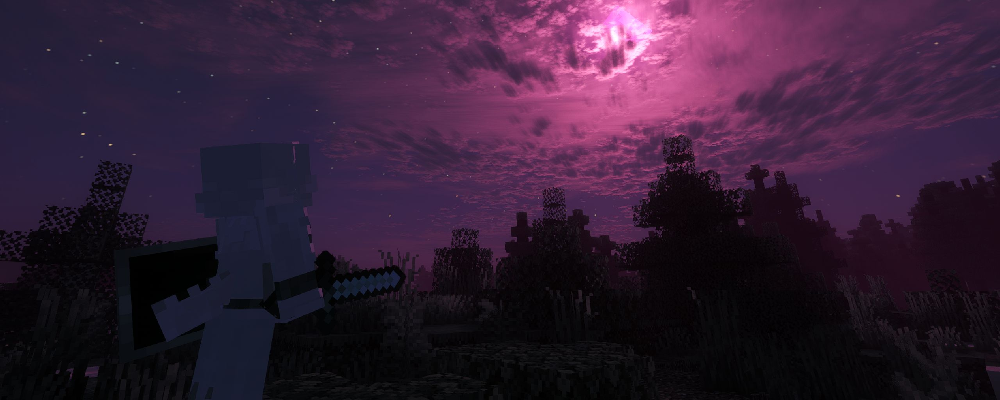

在世界中，有多种物品与事件可以影响你当前的形态

# 诅咒之月事件

每隔一段时间，当时间处于夜晚时可能会触发`诅咒之月事件`。这一事件是全局的

对于1.0.6版本以及以上的版本，诅咒之月事件被设定为在固定的月相触发。触发间隔时间在2-3天（之前的触发方式bug实在太多了！）

`诅咒之月事件`会持续一整夜，且默认无法在此期间睡眠。这一事件会造成一系列影响：

- 生物会掉落`未加工的月尘`

- 当处于`开书后的默认形态`时，你的形态会随机变为某个`阶段变化形态`的`初始阶段`，`诅咒之月事件`结束即复原

- 当处于`阶段变化形态`的`初始阶段`或`第一阶段`时，你的形态会暂时提升一个阶段，`诅咒之月事件`结束即复原

- 当处于`阶段变化形态`的`第二阶段`时，你的形态会暂时退回到这一形态的`初始阶段`，`诅咒之月事件`结束即复原。这也是您使用`抑制剂`或`金苹果`复原的机会

- 如果在诅咒之月期间，你的形态因使用`抑制剂`、`金苹果`或指令等原因发生了其他变化，月落时不再会强行将你拉回原本形态

- 注意：对于某些推进条件较为特殊的形态（如蜘蛛形态），`诅咒之月事件`的影响可能会稍有不同，请参考形态的相关说明

- 服务端也可以通过配置项 `enableCursedMoonTransform` 关闭诅咒之月的强制变形效果

# 形态的回退与恢复

- **金苹果**：降低`本能值`并解除`形态变化效果`；在1.10.0版本之后，处于`初始阶段`时食用`金苹果`可直接退回变身前的形态（注意：`牛奶`不再能解除`形态变化效果`）

- **抑制剂 / 强效抑制剂**：普通`抑制剂`可回退`初始阶段`、`第一阶段`与`特殊形态`；`强效抑制剂`可将非永久形态（包括`第二阶段`）直接还原至初始阶段

- **历史与安全回退**：模组会记录玩家的形态变化历史，用于准确还原上一形态；如果当前形态因数据包移除等原因不再可用，系统会自动将其安全回退至可用形态