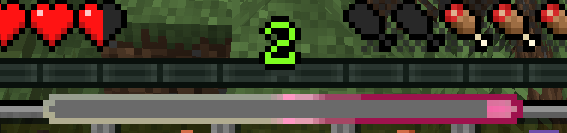

# 形态种类

在mod中，您可以变成的形态会被分为`阶段变化形态`、`特殊形态`、`永久形态`与`子形态`

# 阶段变化形态

`阶段变化形态`具有多个逐渐变化的阶段形态。在1.10.0版本之后，阶段命名统一为`初始阶段`、`第一阶段`、`第二阶段`以及对应的`永久阶段`

对于`阶段变化形态`而言，随着`本能值`的累积，您的形态将会进入下一个阶段

对于某个形态，相较于前期阶段而言，后期阶段的优势与劣势都会更加明显，对于游戏体验的改变也会更加突出

当处于`阶段变化形态`时，你的形态会受到`诅咒之月事件`的影响

mod中的大部分形态属于这一类别

### 本能系统

`本能系统`的进度条位于屏幕正中，经验槽的下方。它指示您当前`本能值`的大小

`本能值`会随时间缓慢增加。除此之外，每个形态都有其对应的`本能行为`，触发这些行为也会导致`本能值`迅速增加

当`本能值`涨满时，您的形态将进入下一个阶段

在进入`第二阶段`后，本能条会处于锁定状态（需使用`共鸣催化剂`进入永久阶段）；进入`永久阶段`或`特殊形态`后，本能条会自动隐藏

### 渐进式形态列表

- 豹猫形态（初始 / 第一 / 第二阶段）

- 美西螈形态（初始 / 第一 / 第二阶段）

- 蝙蝠形态（初始 / 第一 / 第二阶段）

- 使魔红狐形态（初始 / 第一 / 第二阶段）

- 雪狐形态（初始 / 第一 / 第二阶段）

- 胡狼形态（初始 / 第一 / 第二阶段）

- 蜘蛛形态（初始 / 第一 / 第二阶段）

# 特殊形态

`特殊形态`不存在阶段。它也不会受到`诅咒之月`的影响

在`特殊形态`时，您可以随时使用一剂`抑制剂`来恢复到初始形态

### 特殊形态列表

- 悦灵形态

- 野性猫之形态

# 永久形态

`永久形态`是`阶段变化形态`的最终阶段（即`永久阶段`）

对于某个包含`永久形态`的`阶段变化形态`而言，在形态的`第二阶段`，使用一剂`共鸣催化剂`来变成对应的永久形态

到达永久形态后，你可以借助`形态调谐信标`解锁该形态专属的`技能树`（Perk），详见`形态调谐与技能树`一节

**注意：一旦变成某个永久形态，就没有任何游戏内的机制可以将其恢复，请谨慎行事**

!!! note

    Q: 我后悔了！真的没有其它办法了么？

    A: 有的兄弟有的，在管理员权限下，您可以使用指令 `/shape_shifter_curse transform_to_form` 来设定形态，或在创造模式下使用`极效抑制剂`恢复

### 永久形态列表

- 豹猫形态（永久阶段）

- 美西螈形态（永久阶段）

- 蝙蝠形态（永久阶段）

- 使魔红狐形态（永久阶段）

- 雪狐形态（永久阶段）

- 胡狼形态（永久阶段）

- 蜘蛛形态（永久阶段）

# 子形态

部分形态在进入`永久阶段`后，可以通过`波纹之镜`切换为对应的`子形态`，并可随时切回主形态

详见`子形态`一节

