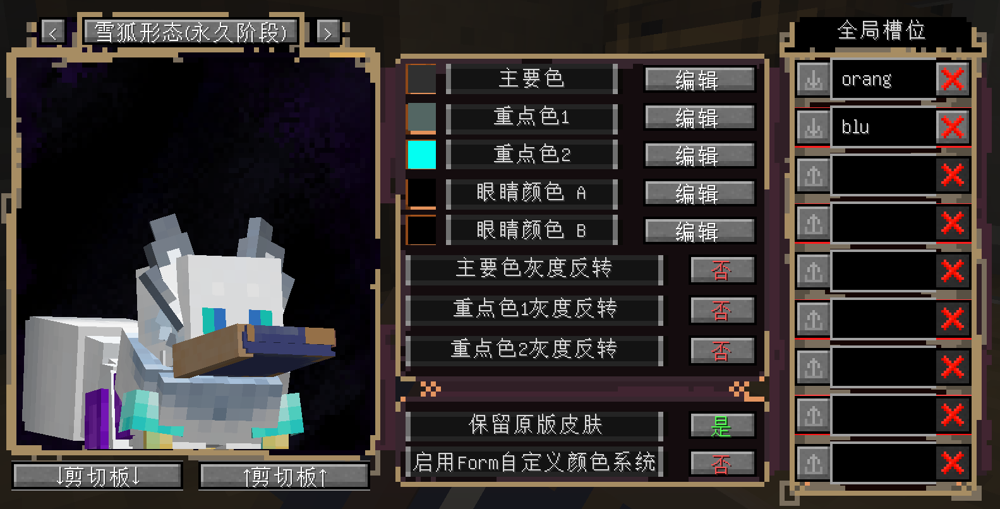
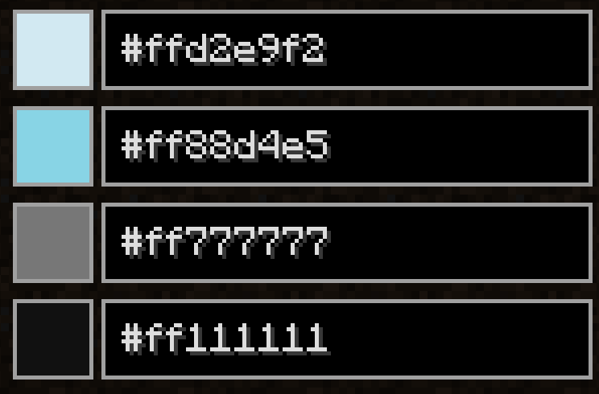

# Mod可配置项

强烈推荐您安装[Mod Menu](https://www.curseforge.com/minecraft/mc-mods/modmenu)来进行模组的配置

### 玩家自定义配置项

配置文件路径：`config\shape-shifter-curse-client-custom.toml`

在1.9.2版本之后，推荐直接通过`幻形者之书`中的调色按钮或 Mod Menu 打开**可视交互调色菜单**实时预览并调整形态颜色，无需手动换算十六进制数值

如需手动修改配置文件，常用配置项如下：

- `keep_original_skin = true`

        是否保留你的原本皮肤

- `enable_form_color = true`

        是否启用形态颜色自定义功能

- `primaryColor = 13822450`

        形态的主要颜色（16进制颜色转为10进制后的数值）

- `accentColor1Color = 8967397`

        形态的强调颜色1

- `accentColor2Color = 7829367`

        形态的强调颜色2

- `eyeColor = 1118481`

        形态的眼睛颜色。只有在眼睛颜色被覆盖的形态下才会生效

- `primaryGreyReverse = false` / `accent1GreyReverse = false` / `accent2GreyReverse = false`

        是否反转对应区域的灰度值。形态的自定义颜色会混合原本贴图的灰度纹路来实现更加自然的效果

在1.0.73版本后形态颜色配置中，alpha通道（即Hex格式颜色值的前两位）表示是否覆盖形态的原本贴图颜色，只接受FF与00两种输入。当设置为00时，对应区域将使用原本的贴图颜色，可用于仅覆盖眼睛颜色等需求

### 客户端配置项

配置文件路径：`config\shape-shifter-curse-client.toml`

- `enableFormModelOnVanillaFirstPersonRender = true`

        用于确定是否在原版第一人称渲染不同形态的手臂模型。如果在第一人称时体验到卡顿，建议设为 false

- `newStartBookForBiggerScreen = false`

        是否要启用扩大尺寸的幻形者之书页面。对于高分辨率屏幕下 UI 过小的情况建议设为 true

- `minBlinkIntervalTick = 60` / `maxBlinkIntervalTick = 140` / `blinkTick = 4`

        控制形态眨眼动画的最小间隔、最大间隔与闭眼持续时长（单位：tick）

- `fcs_use_v1_menu = false`

        是否切换为专业版形态调色菜单（V1）。默认使用更精简的标准版（V2）

- `disableUnlockCheckInFormColorSelectMenu = false`

        是否在形态调色菜单中禁用形态解锁检查（设为 true 可直接预览和调整尚未解锁形态的配色）

- `enableChangeFPMConfig = true` / `enableBetterCombatFix = true`

        控制是否自动重置 First-person Model 偏移，以及是否启用 Better Combat 兼容修复

- HUD 位置偏移配置

        客户端配置中的 UI 分类提供`本能条`、`魔力条`等 HUD 的锚点位置类型（1~9）与 X/Y 偏移量，可按需微调显示位置

### 服务端通用配置项

配置文件路径：`config\shape-shifter-curse-common.toml`

- `transformativeBatSpawnChance = 0.5` / `transformativeAxolotlSpawnChance = 0.5` / `transformativeOcelotSpawnChance = 0.5` / `transformativeWolfSpawnChance = 0.5` / `transformativeSpiderSpawnChance = 0.5`

        分别设置咒文蝙蝠、美西螈、豹猫、狼与蜘蛛的刷新概率（设为 0 可禁用对应刷怪）

- `curseMoonPhase = [1, 5]`

        设置触发诅咒之月事件的月相（范围 0~7，清空数组可禁用诅咒之月事件；修改后需重启游戏或服务器生效）

- `allowSleepInCursedMoon = false`

        是否可以在诅咒之月事件中睡眠，默认为 false。若为 true，醒来后形态将恢复到诅咒之月生效前的形态

- `enableCursedMoonTransform = true`

        诅咒之月升起时是否触发强制变形。设为 false 后仅保留事件与掉落，不改变玩家形态

- `enableInitialForm = false`

        是否启用服务端自定义初始形态功能（需同时保持游戏规则 `sscUseInitialForm` 为 true）

- `initialFormIds = ["shape-shifter-curse:original_before_enable:1"]`

        自定义初始形态候选列表，格式为 `命名空间:形态ID:权重`（支持数据包形态），新玩家加入世界时按权重随机抽取。详见`开启模组内容`一节

- `immediatelyTransform = false`

        是否跳过变形渐变动画，瞬间完成变形

- `statusPotionWithCurse = false` / `witchPotionForPreBook = false`

        分别控制变形药水是否对尚未打开幻形者之书的玩家生效，以及女巫是否会向未开书玩家投掷形态药水

- `enableFoodHabitSystem = true`

        是否启用形态的食性限制系统

- `enableFullStackUpgrade = true`

        是否允许锻造台塑形升级支持整组物品（如与其他模组产生刷物品冲突可将其关闭）
