# 模组添加的物品

本章节列举了这一模组所添加的物品以及其合成表

## 基本物品

### 未加工的月尘

`未加工的月尘`是模组的核心物品。涉及到模组的大部分内容

`未加工的月尘`会在`诅咒之月`期间从生物身上掉落

在1.8.1版本后，为了适配不开启`诅咒之月事件`的玩法，添加了`未加工的月尘`的合成表

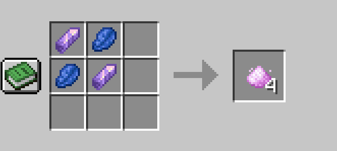

### 月尘晶砾

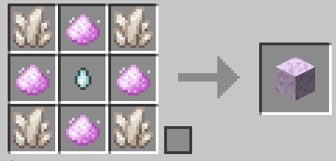

`月尘晶砾`是可合成的可放置方块物品。`月尘纯晶`需要使用`月尘晶砾`熔炼而成

详见`形态专属工具与饰品`一节

### 月尘纯晶

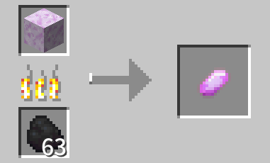

`月尘纯晶`是合成形态专属工具、饰品及祭坛配方的重要进阶材料，可以通过熔炼`月尘晶砾`或在`幻形祭坛`中合成获得

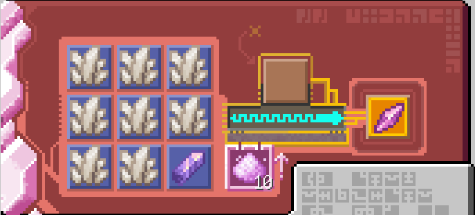

详见`形态专属工具与饰品`与`幻形祭坛与催化核心`一节

### 微光棱柱

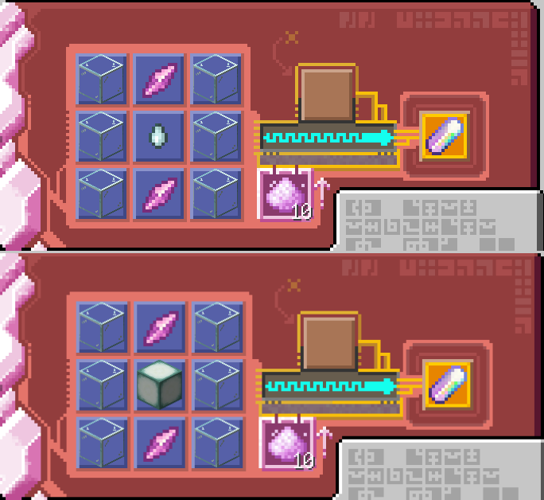

`微光棱柱`需要在`幻形祭坛`中合成（中心可使用海晶灯或恶魂之泪），是合成各类`催化核心`以及解锁高阶`形态技能树`节点的核心材料

## 影响形态的物品

### 月尘基质

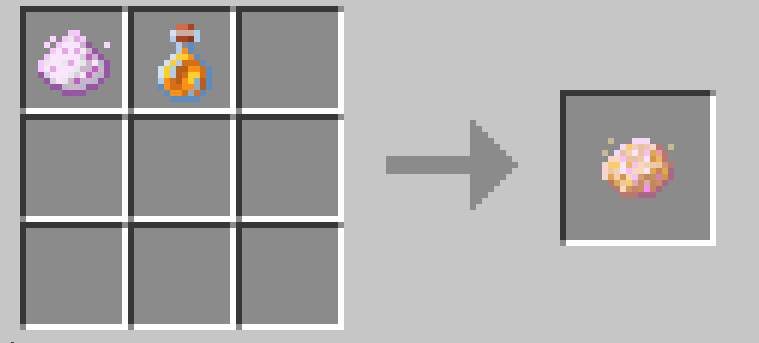

`月尘基质`是炼制`形态药水`以及合成其他相关物品的核心物品

### 催化剂

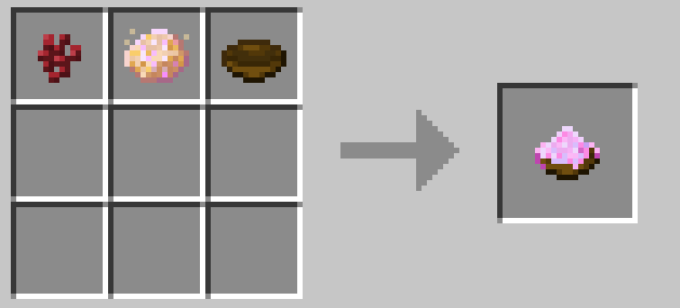

大幅增加你当前的`本能值`

### 抑制剂

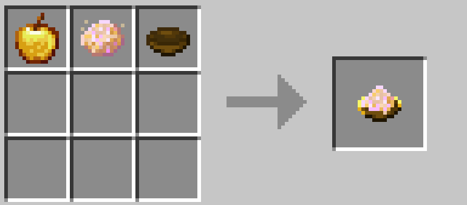

在处于`阶段变化形态`的`初始阶段`、`第一阶段`，或者处于`特殊形态`时使用，将你的形态回退一个阶段；也可用于解除`形态变化效果`

### 金苹果

大幅减少你当前的`本能值`，同时可用于解除`形态变化效果`

在1.10.0版本之后，处于`初始阶段`时食用`金苹果`可以直接退回变身前的形态

### 共鸣催化剂

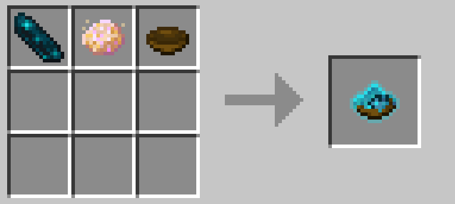

对于某个包含`永久阶段`的`阶段变化形态`而言，在形态的`第二阶段`使用来变成对应的永久形态

### 强效抑制剂

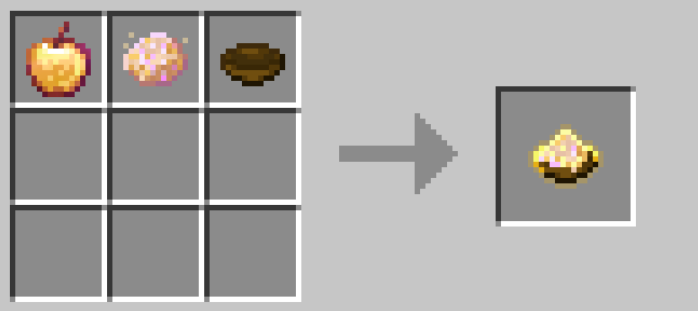

与抑制剂相似，不过它可以对`阶段变化形态`的`第二阶段`生效，将非永久形态直接还原至初始阶段

### 极效抑制剂

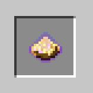

可以将包括永久形态在内的所有形态回退到初始形态的物品，无法合成，仅能在创造模式下获取

不过你可以通过自行添加合成表的方式让其可以合成

### 波纹之镜

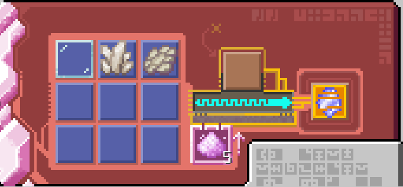

在`幻形祭坛`中合成。处于包含子形态的永久形态时，长按右键使用可以打开`镜中倒影`界面，切换为对应子形态或切回主形态，详见`子形态`一节

## 其他物品

### 燃火符纸与爆炎符纸

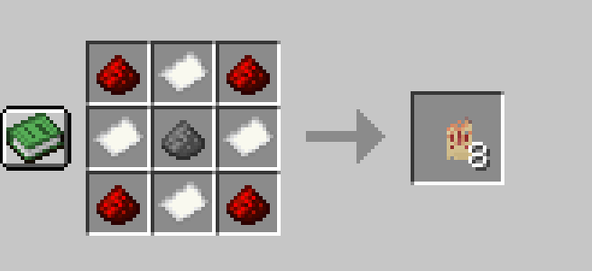

`燃火符纸`是`使魔红狐形态`用于施放强化火球投射物的消耗品

在1.10.0版本之后，还可以在`幻形祭坛`中搭配`磷火催化核心`将其进阶为威力更强的`爆炎符纸`

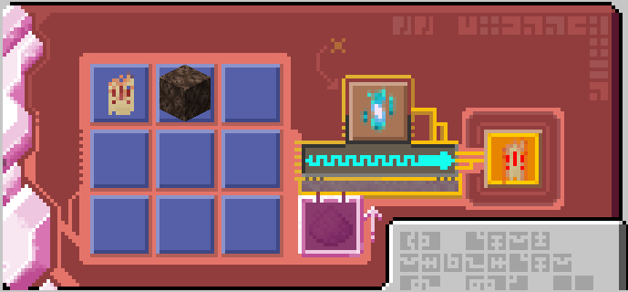

### 魔药符纸

`使魔红狐形态`在解锁对应技能树节点后，可以在背包中消耗魔力与材料制作`治疗 / 伤害 / 剧毒`三种`魔药符纸`，用于发射携带对应药水效果的符箭

## 幻形祭坛、催化核心与调谐信标

详见`幻形祭坛与催化核心`与`形态调谐与技能树`一节

## 形态专属工具与饰品

详见`形态专属工具与饰品`一节

## 塑形盔甲

详见`形态的专属护甲`一节