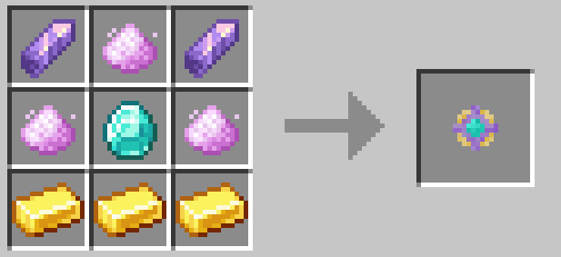
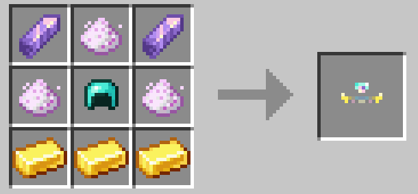
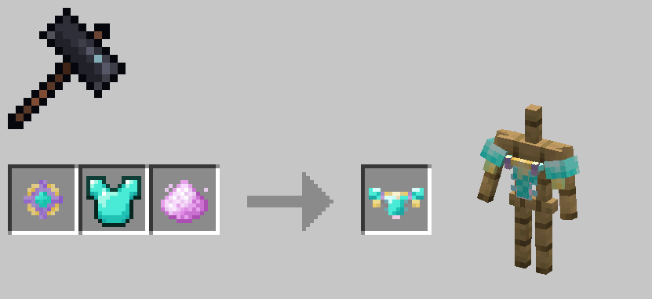
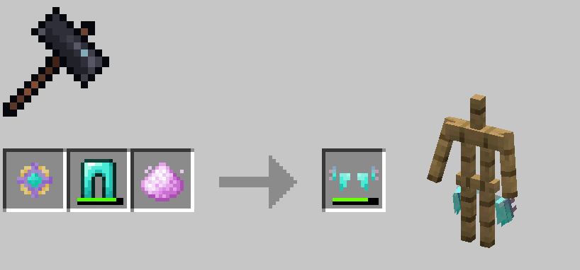
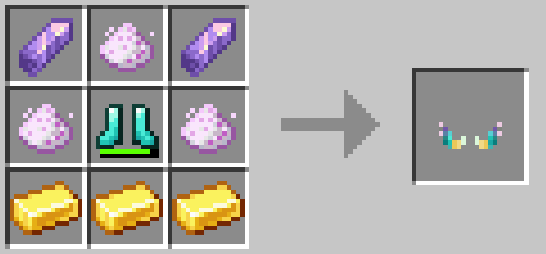
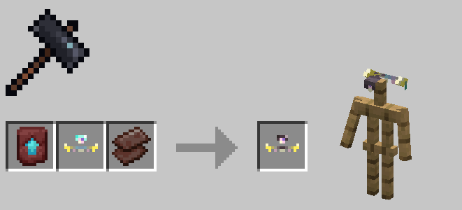
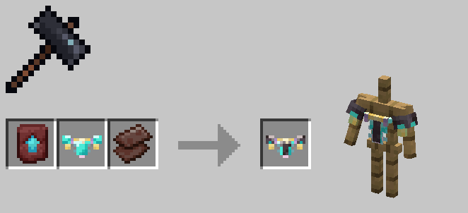
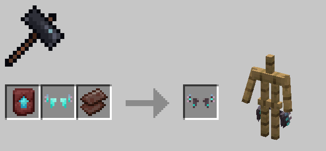
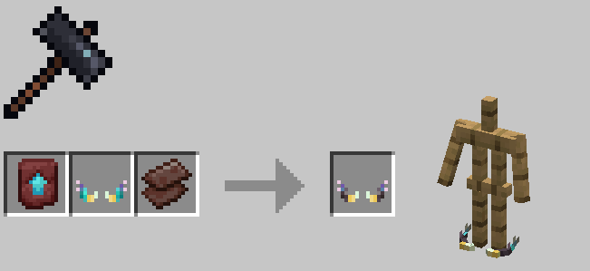
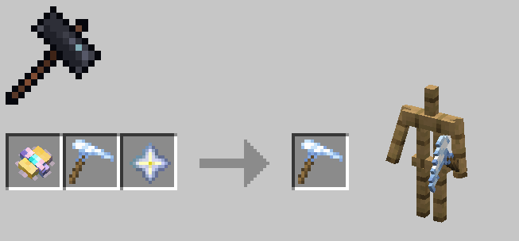

# 塑形盔甲

塑形盔甲在1.0.71版本后加入。它们是游戏中后期的盔甲，可以无视形态的盔甲相关限制，被绝大多数形态装备

在1.0.73版本后，塑形盔甲的合成方式由直接合成变为锻造台锻造，以保留原本装备的附魔

你需要先合成塑形核心，并在锻造台中使用对应钻石装备，塑形核心与未加工的月尘合成塑形护甲

!!! note

	出于显而易见的原因，allay_sp无法装备塑形绑腿与塑形脚镯

---

### 塑形核心

### 塑形头环

| 护甲值 | 盔甲韧性 | 耐久度 |
|:---:|:----:|:---:|
|  2  |  1   | 264 |

### 塑形身甲

| 护甲值 | 盔甲韧性 | 耐久度 |
|:---:|:----:|:---:|
|  7  |  1   | 384 |

### 塑形绑腿

| 护甲值 | 盔甲韧性 | 耐久度 |
|:---:|:----:|:---:|
|  6  |  1   | 360 |

### 塑形脚镯

| 护甲值 | 盔甲韧性 | 耐久度 |
|:---:|:----:|:---:|
|  2  |  1   | 312 |

# 塑形盔甲下界合金升级

1.8.1版本后加入了塑形盔甲的下界合金升级

与原版不同的是，下界合金塑形盔甲的升级与修理使用`下界合金碎片`即可，无需`下界合金锭`

### 下界合金塑形头环

| 护甲值 | 盔甲韧性 | 耐久度 |
|:---:|:----:|:---:|
|  3  |  2   | 481 |

### 下界合金塑形身甲

| 护甲值 | 盔甲韧性 | 耐久度 |
|:---:|:----:|:---:|
|  7  |  2   | 592 |

### 下界合金塑形绑腿

| 护甲值 | 盔甲韧性 | 耐久度 |
|:---:|:----:|:---:|
|  6  |  2   | 555 |

### 下界合金塑形脚镯

| 护甲值 | 盔甲韧性 | 耐久度 |
|:---:|:----:|:---:|
|  3  |  2   | 462 |

# 护甲与工具的塑形属性升级

在1.8.1版本之后，你可以为包含其他模组添加的任意工具与护甲加入塑形属性升级

有塑形属性的工具与护甲可以无视限制，被大部分形态使用与装备。只是由于无法对所有模组内容做适配，一些护甲可能会出现穿模现象

### 方式一：锻造台升级

你可以在锻造台中使用`塑形核心`与`下界之星`为装备进行塑形属性升级

### 方式二：幻形祭坛升级（1.10.0 新增）

在1.10.0版本之后，你可以先在`幻形祭坛`中合成`塑形催化核心`

随后将`塑形催化核心`放入祭坛的催化槽中（**不会被消耗**），将任意一件待升级的装备单独放入 3×3 输入槽，消耗 32 份`未加工的月尘`即可为其赋予塑形属性

!!! note

    如果你需要让形态无视食性限制食用任意食物，也可以在`幻形祭坛`中制作`塑形食物`，详见`幻形祭坛与催化核心`一节
