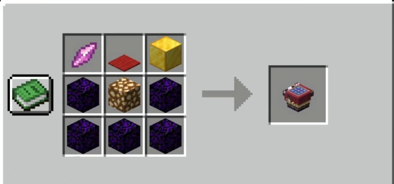
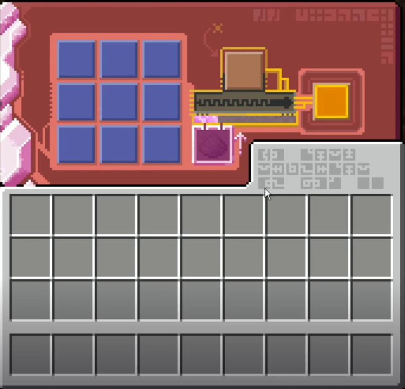
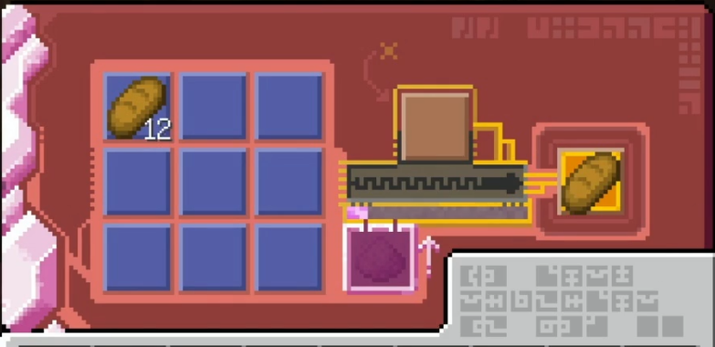

# 幻形祭坛与催化核心

在1.10.0版本之后，模组加入了`幻形祭坛`方块以及一系列`催化核心`，构成了中后期的合成与强化体系

## 幻形祭坛

`幻形祭坛`是由月尘魔力驱动的物质嬗变方块。模组中的各类形态饰品、`+`进阶饰品、催化核心、系统关键材料以及`塑形食物`都需要在这里制作

右键打开祭坛界面后，包含四个区域：

- **3×3 输入槽**：摆放合成配方所需的材料
- **催化槽**：放入对应配方所需的`催化核心`（**催化核心在合成过程中不会被消耗**）
- **燃料槽**：放入`未加工的月尘`作为祭坛运作的燃料
- **输出槽**：取出嬗变完成后的成品

## 催化核心

`催化核心`是用于升级形态饰品、符纸与塑形装备的进阶催化剂，均在`幻形祭坛`中以`微光棱柱`为核心合成（`塑形催化核心`以`月尘纯晶`为核心）

制作完成后，将其放入祭坛的催化槽即可反复使用，不会消耗

| 催化核心 | 主要用途 |
| :---: | --- |
| 密林催化核心 | 升级豹猫形态饰品（`猫胡须颈环+`、`消化毛球+`） |
| 丝网催化核心 | 升级蜘蛛形态饰品（`箭毒纺锤+`） |
| 冻霜催化核心 | 升级雪狐形态饰品与工具（`瓶装暴雪+`、`计度温护符+`、`结霜护爪+`） |
| 磷火催化核心 | 升级使魔红狐饰品与符纸（`守御脚环+`、`爆炎符纸`） |
| 浪涌催化核心 | 升级美西螈形态饰品（`喷泉腰带+`） |
| 沙丘催化核心 | 升级胡狼形态饰品（`凋零裹布+`） |
| 暗夜催化核心 | 升级蝙蝠形态饰品（`固着抓钩+`、`空心牙吊坠+`、`黑夜水晶吊坠+`） |
| 塑形催化核心 | 在祭坛中为任意护甲与工具赋予塑形属性 |

## 塑形食物

将任意一种食物**单独**放入祭坛的 3×3 输入槽中（其余输入槽与催化槽留空），消耗少量月尘燃料即可将其转化为`塑形食物`

带有`塑形食物`标签的食物可以无视当前形态的食性限制，被所有形态正常食用

## 其他主要产出

除了基础形态饰品与`+`进阶升级外，你还可以在`幻形祭坛`中合成以下核心物品：

- `微光棱柱`：用于合成催化核心，也是解锁高阶形态技能树节点的消耗材料
- `波纹之镜`：用于在永久阶段切换`子形态`
- `形态调谐信标`：用于开启形态技能树
- `月尘纯晶`：除熔炼`月尘晶砾`外，也可在祭坛中直接合成
- `装备塑形升级`：搭配`塑形催化核心`为任意装备赋予塑形属性，详见`形态的专属护甲`一节
