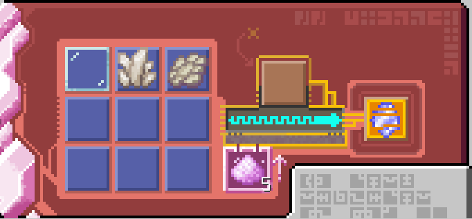
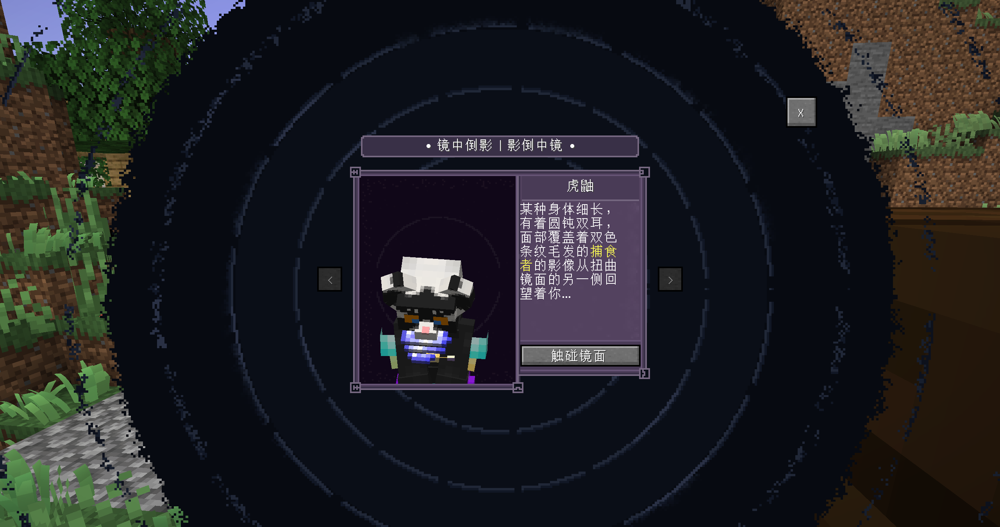

# 子形态

在1.10.0版本之后，部分形态在达到`永久阶段`后，可以切换为对应的`子形态`

`子形态`拥有独立的外观、动画、优劣势以及专属的技能树，为你提供与主形态截然不同的游玩风格

## 如何切换子形态

要切换子形态，你需要处于对应主形态的`永久阶段`，并在`幻形祭坛`中合成`波纹之镜`

长按右键使用`波纹之镜`，即可打开`镜中倒影`界面，预览并选择想要切换的目标形态

确认切换后会消耗一面`波纹之镜`（仅打开界面查看不会消耗）

## 子形态的特性

- **可随时切回主形态**：在子形态下再次使用`波纹之镜`，即可在`镜中倒影`界面中切回原本的主形态（不能跨形态组切换）

- **沿用主形态饰品**：子形态与主形态共享基础形态层，因此可以直接使用主形态的专属饰品

- **独立技能树**：每个子形态都有属于自己的技能树，可以通过`形态调谐信标`进行解锁

---

## 现有子形态列表

### 蝙蝠形态（永久阶段）

- **Avali（羽族）**：来自另一位面的外星猛禽🍐，它为什么会出现在这里呢？

### 雪狐形态（永久阶段）

- **虎鼬（Marbled Polecat）**：身形修长的敏捷猎手。它拥有非常灵活的脖子
